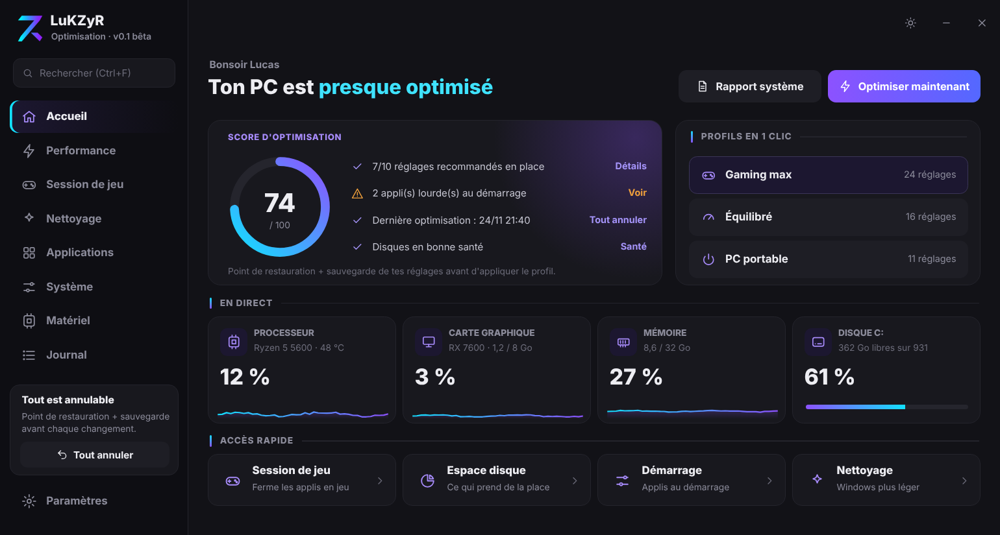
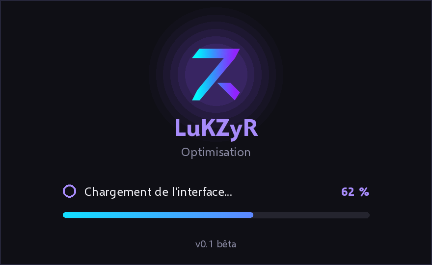

<p align="center">
  
</p>

<h1 align="center">LuKZyR Optimisation</h1>
<p align="center">v0.2 bêta · Windows 10 / 11</p>

LuKZyR Optimisation est une petite application Windows (PowerShell 5.1 + WinForms, sans
installation) qui rend un PC de jeu plus réactif **sans casser Windows** : chaque réglage
est expliqué, marqué **SÛR / AVANCÉ / DÉFINITIF**, sauvegardé avant modification et
annulable en un clic avec **« Tout annuler »**.

> **Statut : v0.2 bêta.** Testée, mais encore sur peu de PC différents. En cas de souci :
> Journal > « Exporter le journal », puis signale-le sur le
> [serveur Discord](https://discord.gg/2RrjqvC5vv) avec le fichier.

## Notes de version

### v0.2 bêta · build 6.2

- La barre des tâches de Windows associe le logo **LuKZyR** au lanceur, à l’écran
  de chargement et à la fenêtre principale. Un raccourci épinglé depuis
  l’application relance le lanceur LuKZyR.

## Aperçu

<p align="center">
  
</p>
<p align="center">
  
</p>
<p align="center">
  
</p>

## Interface et outils

- **Barre latérale** : logo, recherche (Ctrl+F) dans tous les
  réglages, une icône par section, encadré « Sauvegarde des réglages » avec le bouton
  « Tout annuler » toujours à portée de main.
- **Tableau de bord** : état du PC, **score d'optimisation** sur 100 (calculé
  uniquement avec ce qui est lu sur ton PC, sans rien modifier, détail point par point),
  profils en 1 clic, 4 cartes en direct (processeur, carte graphique, mémoire, disque C:)
  avec courbe, accès rapide.
- **Session de jeu** : ferme les applis inutiles pendant que tu joues (OneDrive, Teams,
  Widgets…) puis les relance à la fin. Rien n'est désinstallé.
- **Espace disque** : ce qui prend de la place (dossiers personnels, jeux Steam,
  temporaires…), en lecture seule.
- **Rapport système** : matériel, pilotes, Windows et réglages appliqués dans un fichier
  HTML + texte sur le Bureau. Rien n'est envoyé.

## Fonctionnalités

- **Optimiser en 1 clic** : profils *Gaming max*, *Équilibré* et *PC portable*
  (conseillé automatiquement si une batterie est détectée). Point de restauration et
  sauvegarde des réglages d'origine avant toute modification.
- **Performance** : Mode Jeu, priorité aux jeux, planification GPU accélérée, souris sans
  accélération, optimisations des jeux en fenêtre, optimisations VRR, plan d'alimentation
  (*Utilisation normale*, conseillé pour Ryzen, ou *Performances élevées*, gain honnête de
  0 à 2 %), mode *Meilleures performances* de Windows 11, carte graphique puissante pour
  les jeux (PC à 2 cartes), hibernation (jamais sur un PC avec batterie),
  transparence, applis de démarrage sans délai, Edge sans préchargement, applis du Store
  en arrière-plan (optionnel).
- **Vérifications (lecture seule)** : fréquence de l'écran, Resizable BAR / Smart Access
  Memory, Radeon Anti-Lag, Ne pas déranger en jeu, indexation de la recherche, effets
  d'animation de Windows, chacune avec un bouton vers le bon réglage.
- **Nettoyage** : fichiers temporaires, caches, assistant de stockage, entretien de
  Windows (WinSxS, **jamais** `/ResetBase`), applications préinstallées, antivirus
  et VPN tiers, télémétrie.
- **Applications** : installation depuis les sources officielles (winget) : Steam, Epic
  Games, Ubisoft Connect, Discord, Spotify, Brave, OBS Studio, 7-Zip, VLC…
- **Système** : applis au démarrage, DNS et partage des mises à jour dans **Réseau**,
  espace disque, TRIM, Optimiser les lecteurs, VBS (avancé), réparation DISM + SFC,
  Restaurer le système.
- **Réparer** : remet à la valeur de Windows les réglages nuisibles laissés par d'autres
  « optimiseurs » (démarrage forcé, fichier d'échange, services utiles coupés, valeurs
  « magiques »…) et propose de désactiver les tâches planifiées d'autres éditeurs
  (décochées par défaut, annulables). Windows Update, Defender et l'Optimisation de la
  distribution sont seulement affichés.
- **Diagnostic (lecture seule)** : dual channel, lien PCIe de la carte graphique, pilote
  chipset AMD, Ryzen X3D, version de Windows pour les Ryzen, jeux sur disque dur, réglage
  conseillé pour un écran FreeSync / G-Sync, avec quoi faire.
- **Matériel** : composants détectés, pilotes officiels, santé des disques, température,
  guide BIOS adapté à la carte mère détectée (rien n'est jamais modifié dans le BIOS).
- Thème clair / sombre, français / anglais, animations douces et économes : un seul
  minuteur qui s'arrête dès que rien ne bouge, pause quand la fenêtre est réduite ou
  inactive, réglage Windows « Effets d'animation » respecté, option « Animations réduites ».

## Ce que LuKZyR Optimisation ne touche jamais

- Windows Defender
- Windows Update (le service d'Optimisation de la distribution n'est jamais désactivé)
- Le Microsoft Store et les composants Xbox
- Les pilotes : aucun pilote n'est supprimé, et l'appli n'installe ni ne fournit aucun
  pilote noyau
- Le BIOS (seulement un guide à lire)

Les valeurs d'origine sont enregistrées dans `C:\ProgramData\Lukzyr\sauvegarde-reglages.json`,
les préférences dans `HKCU\Software\Lukzyr`.

## Installation

1. Télécharge le [ZIP de la v0.2 bêta, build 6.2](downloads/LuKZyR-Optimisation-v0.2-beta-build-6.2.zip?raw=true)
   et **dézippe tout le dossier**.
2. Double-clique sur l'exe à la racine du dossier (ou, en secours, sur le
   fichier .bat « LANCER ») et accepte la demande administrateur.
3. L'exe n'est pas signé : SmartScreen peut afficher un avertissement
   (« Informations complémentaires » > « Exécuter quand même »).

L'appli vérifie elle-même s'il existe une nouvelle version (fichier `version.json` de ce
dépôt) et ne se met jamais à jour sans ton accord.

### Publication d’un nouveau build

1. Dépose le ZIP versionné dans `downloads/`.
2. Remplace les **Notes de version** de ce README et de `LISEZ-MOI.txt` par
   celles du build publié. Mets le numéro public, le build et les changements
   dans chaque note, puis actualise le lien de la section **Installation**.
3. Renseigne le build, le lien HTTPS du ZIP, le résumé et l’empreinte SHA-256
   dans `version.json`. Vérifie le téléchargement et son empreinte avant de
   publier la mise à jour.

### Depuis les sources

Les sources ne contiennent aucun exe ni DLL compilé. Pour les recréer avec le compilateur C# fourni
avec Windows (.NET Framework 4, rien à installer) :

```bat
assets\source-lanceur\Compiler-Lanceur.bat
```

Il produit l'exe du lanceur à la racine et `scripts\LkChargement.dll` (écran de
chargement). Sans eux, le fichier .bat « LANCER » lance directement le script principal
de `scripts\` en administrateur (écran de chargement de secours).

## Structure

```
scripts\                  Interface et scripts PowerShell (Windows PowerShell 5.1)
assets\                   Logo et icône
assets\source-lanceur\    Source C# du lanceur et de l'écran de chargement, Compiler-Lanceur.bat, logo d'origine
guides\                   Guide BIOS générique
docs\                     Captures d'écran
downloads\                Archives ZIP versionnées
version.json              Dernière version publiée (vérification des mises à jour)
LISEZ-MOI.txt             Mode d'emploi détaillé (aussi fourni dans le zip)
```

## Signaler un bug

Un problème ? Rejoins le **[serveur Discord de LuKZyR](https://discord.gg/2RrjqvC5vv)**
(aussi accessible depuis l'appli : **Paramètres > « Signaler un bug (Discord) »**).

- Explique ce que tu faisais quand le problème est arrivé.
- Joins le journal : Journal > « Exporter le journal ».
- Si l'appli ne démarre pas : joins `C:\ProgramData\Lukzyr\plantage-demarrage.txt`
  (ou `erreurs-interface.txt` pour un souci d'affichage).

## Crédits

LuKZyR Optimisation. © 2026 Lukzyr.
