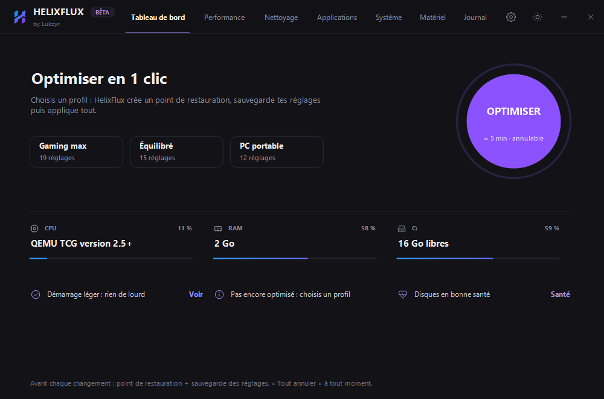
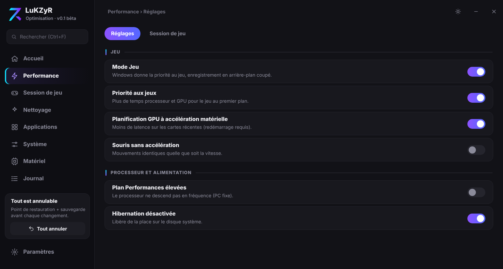
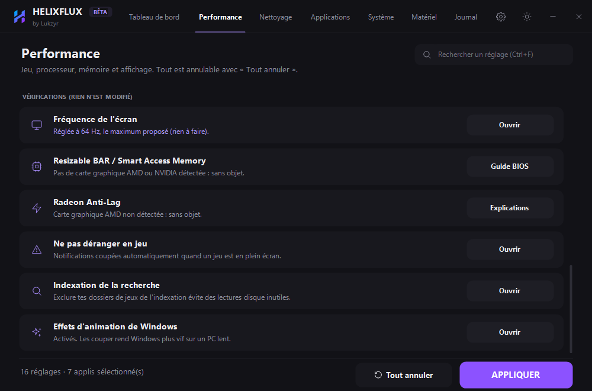
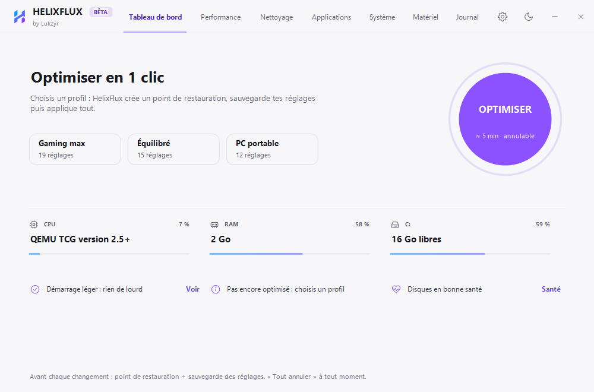
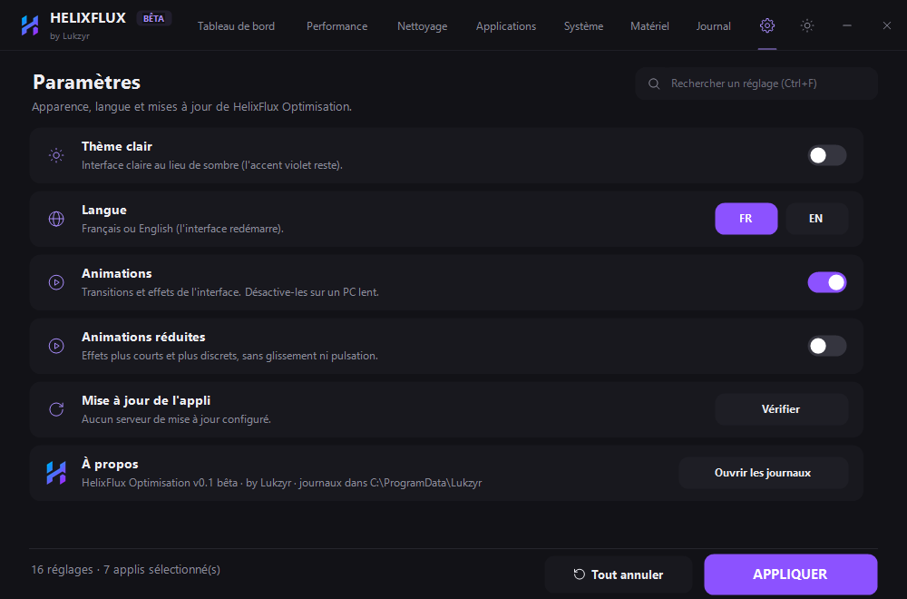
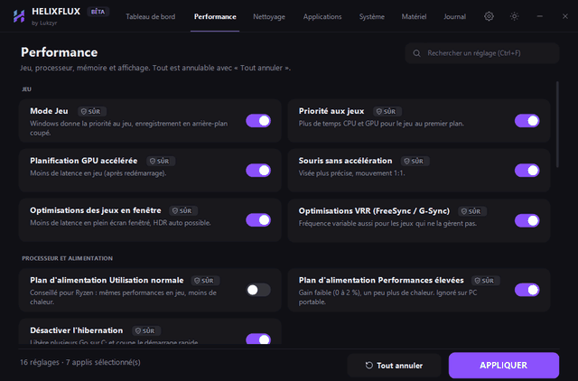

<p align="center">
  
</p>

<h1 align="center">HelixFlux Optimisation</h1>
<p align="center"><b>by Lukzyr</b> · v0.1 bêta · Windows 10 / 11</p>

<p align="center">
  
</p>

HelixFlux Optimisation est une petite application Windows (PowerShell 5.1 + WinForms, sans
installation) qui rend un PC de jeu plus réactif **sans casser Windows** : chaque réglage
est expliqué, marqué **SÛR / AVANCÉ / DÉFINITIF**, sauvegardé avant modification et
annulable en un clic avec **« Tout annuler »**.

> **Statut : v0.1 bêta.** Testée (machine virtuelle Windows 10), mais encore sur peu de PC
> différents. En cas de souci : Journal > « Exporter le journal », puis ouvre une *issue*
> avec le fichier.

## Captures

| Performance | Vérifications |
|---|---|
|  |  |
| **Thème clair** | **Paramètres** |
|  |  |

<p align="center">
  
  
</p>

## Fonctionnalités

- **Optimiser en 1 clic** : profils *Gaming max*, *Équilibré* et *PC portable*
  (conseillé automatiquement si une batterie est détectée). Point de restauration et
  sauvegarde des réglages d'origine avant toute modification.
- **Performance** : Mode Jeu, priorité aux jeux, planification GPU accélérée, souris sans
  accélération, optimisations des jeux en fenêtre, optimisations VRR, plan d'alimentation
  (*Utilisation normale*, conseillé pour Ryzen, ou *Performances élevées*, gain honnête de
  0 à 2 %), hibernation, VBS (avancé), transparence, applis de démarrage sans délai, Edge
  sans préchargement, applis du Store en arrière-plan (optionnel).
- **Vérifications (lecture seule)** : fréquence de l'écran, Resizable BAR / Smart Access
  Memory, Radeon Anti-Lag, Ne pas déranger en jeu, indexation de la recherche, effets
  d'animation de Windows, chacune avec un bouton vers le bon réglage.
- **Nettoyage** : débloat (publicités, suggestions), télémétrie réduite, Copilot, OneDrive,
  partage des mises à jour, fichiers temporaires, assistant de stockage, nettoyage des
  composants Windows (WinSxS, **jamais** `/ResetBase`).
- **Applications** : installation depuis les sources officielles (winget) : Steam, Epic
  Games, Ubisoft Connect, Discord, Spotify, Brave, OBS Studio, 7-Zip, VLC…
- **Système** : applis au démarrage, DNS (Automatique, Cloudflare, Google, Quad9), TRIM,
  réparation DISM + SFC, Restaurer le système.
- **Matériel** : composants détectés, pilotes officiels, santé des disques, température,
  guide BIOS adapté à la carte mère détectée (rien n'est jamais modifié dans le BIOS).
- Thème clair / sombre, français / anglais, animations douces et économes : un seul
  minuteur qui s'arrête dès que rien ne bouge, pause quand la fenêtre est réduite ou
  inactive, réglage Windows « Effets d'animation » respecté, option « Animations réduites ».

## Ce que HelixFlux ne touche jamais

- Windows Defender et la sécurité Windows
- Windows Update (le service d'Optimisation de la distribution n'est jamais désactivé)
- Le Microsoft Store et les composants Xbox
- Les pilotes : aucun pilote n'est supprimé, et l'appli n'installe ni ne fournit aucun
  pilote noyau
- Le BIOS (seulement un guide à lire)

Les valeurs d'origine sont enregistrées dans `C:\ProgramData\Lukzyr\sauvegarde-reglages.json`,
les préférences dans `HKCU\Software\Lukzyr`.

## Installation

1. Télécharge le zip de la dernière version dans
   [Releases](https://github.com/LuKZyR/HelixFlux-Optimisation/releases) et **dézippe tout
   le dossier** (ne lance pas depuis le zip).
2. Double-clique sur **`HelixFlux Optimisation.exe`** (ou, en secours, sur
   `LANCER - HelixFlux Optimisation.bat`) et accepte la demande administrateur.
3. L'exe n'est pas signé : SmartScreen peut afficher un avertissement
   (« Informations complémentaires » > « Exécuter quand même »).

### Depuis les sources

Le dépôt ne contient aucun exe ni DLL compilé. Pour les recréer avec le compilateur C# fourni
avec Windows (.NET Framework 4, rien à installer) :

```bat
assets\source-lanceur\Compiler-Lanceur.bat
```

Il produit `HelixFlux Optimisation.exe` à la racine et `scripts\LkChargement.dll` (écran de
chargement). Sans eux, `LANCER - HelixFlux Optimisation.bat` lance directement
`scripts\HelixFlux-Optimisation.ps1` en administrateur (écran de chargement de secours).

## Structure

```
scripts\                  Interface et scripts PowerShell (Windows PowerShell 5.1)
assets\                   logo.png, helixflux.ico
assets\source-lanceur\    Source C# du lanceur et de l'écran de chargement, Compiler-Lanceur.bat, logo d'origine
guides\                   Guide BIOS générique
docs\                     Captures d'écran
LISEZ-MOI.txt             Mode d'emploi détaillé (aussi fourni dans le zip)
```

## Crédits

HelixFlux Optimisation, **by Lukzyr**. © 2026 Lukzyr.
